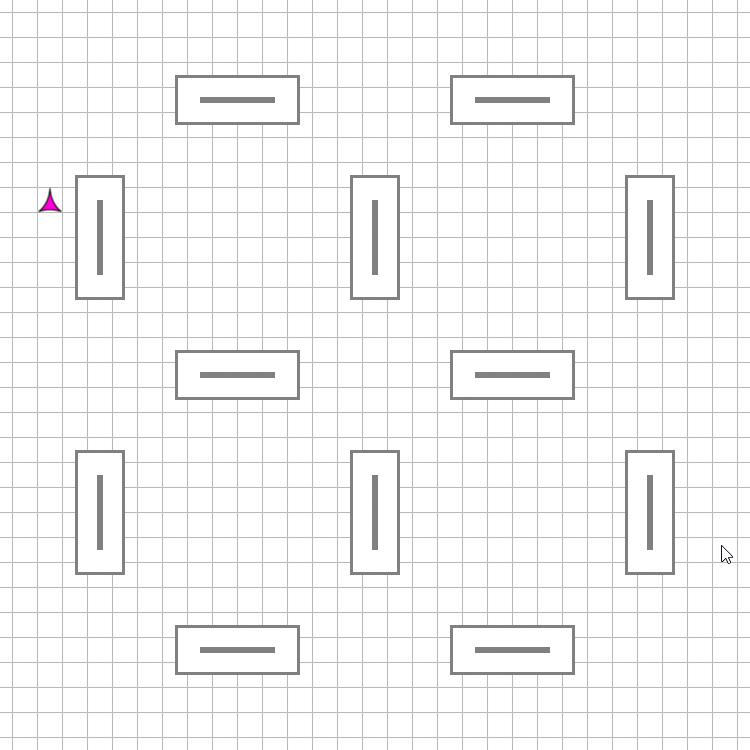
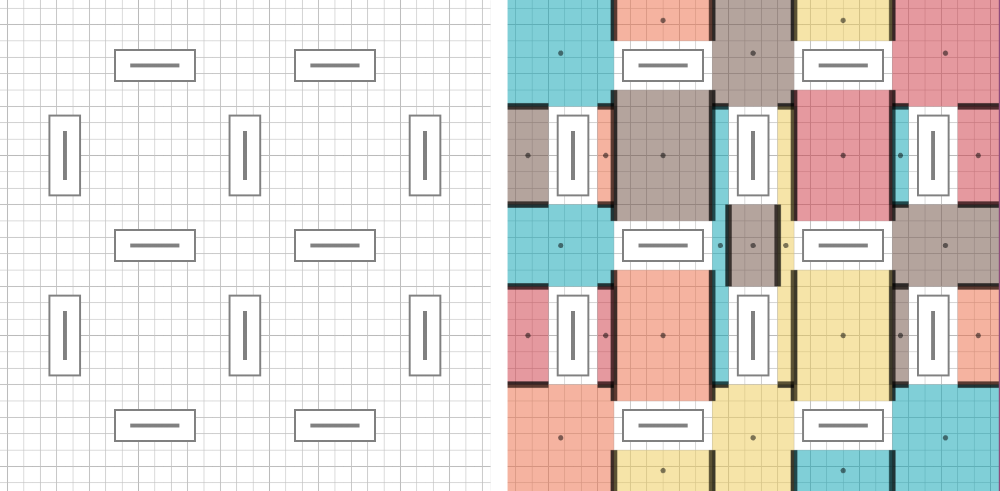

# Navigation Meshes Overview <!-- omit in toc -->

A JS plugin for fast pathfinding using [navigation meshes](https://en.wikipedia.org/wiki/Navigation_mesh), with optional wrappers for the Phaser v3 and v4 game engines.

[](https://www.mikewesthad.com/navmesh/demo/)

[Interactive demo](https://www.mikewesthad.com/navmesh/demo/)

(Note: if you are viewing this on GitHub or NPM, you might want to check out the HTML documentation [here](https://www.mikewesthad.com/navmesh/docs/).)

Table of Contents:

- [Introduction](#introduction)
- [Installation](#installation)
  - [As a Script](#as-a-script)
  - [As a Module](#as-a-module)
- [Creating a Navigation Mesh](#creating-a-navigation-mesh)
- [Usage](#usage)
  - [navmesh (API reference)](#navmesh-api-reference)
  - [phaser-navmesh (API reference)](#phaser-navmesh-api-reference)
- [Performance Comparison](#performance-comparison)
- [Community Examples](#community-examples)
- [Development](#development)
- [Changelogs](#changelogs)
- [References](#references)
- [To Dos](#to-dos)

## Introduction

Pathfinding is essentially the problem of solving a maze, finding a path between points while avoiding obstacles. When pathfinding in games, we need to:

1.  Represent the game world in a way that defines what areas are walkable.
2.  Search that representation for the shortest path.

When it comes to 2D pathfinding, a common approach is to represent the world using [tiles](https://developer.mozilla.org/en-US/docs/Games/Techniques/Tilemaps) (a grid) and then search for a path using the [A\* algorithm](https://en.wikipedia.org/wiki/A*_search_algorithm) (e.g. [Phaser AStar](https://github.com/photonstorm/phaser-plugins/tree/master/AStar)). If you have a 50 x 50 tile world, searching for a path involves searching through a representation of the world with up to 2500 locations/nodes (50 x 50 = 2500).

This plugin uses navigation meshes to simplify that search. Instead of representing the world as a grid of tiles, it represents the walkable areas of the world as a mesh. That means that the representation of the world has far fewer nodes, and hence, can be searched much faster than the grid approach. This approach is 5x - 150x faster than Phaser's A\* plugin (see performance section), depending on the mesh.

The example map below (left) is a 30 x 30 map. As a grid, there are 900 nodes, but as a navmesh (right) there are 27 nodes (colored rectangles).



## Installation

This repository contains 2 related JS packages:

- `navmesh` - core logic, game-engine agnostic, usable outside of Phaser.
- `phaser-navmesh` - Phaser v3 & v4 wrapper around `navmesh` that creates a Phaser Scene plugin. Phaser (v3.55+ or v4) is expected to be a dependency in your project.

You can use any of them as a script or as a module in your bundler of choice.

### As a Script

You can drop in any of the transpiled code into your project as a standalone script. Download the version that you want from the [GitHub release](https://github.com/mikewesthad/navmesh/releases/tag/2.1.0).

E.g. if you wanted phaser-navmesh, you would add this to your HTML:

```html
<script src="phaser-navmesh.min.js"></script>
```

Inside of your own script, you can now use the global variable `PhaserNavMeshPlugin` (see library name in the above table), e.g.

```js
const game = new Phaser.Game({
  type: Phaser.AUTO,
  width: 750,
  height: 750,
  plugins: {
    scene: [
      { key: "NavMeshPlugin", plugin: PhaserNavMeshPlugin, mapping: "navMeshPlugin", start: true },
    ],
  },
});
```

See [usage](#usage) for more information on how to use each of the three modules in this repository.

### As a Module

Install the appropriate dependency:

- `npm install --save navmesh` for usage outside of Phaser
- `npm install --save phaser-navmesh` for Phaser 3 or 4

To use the transpiled and minified distribution of the library (recommended for most users):

```js
// Phaser 3 or 4
import { PhaserNavMeshPlugin } from "phaser-navmesh";

// NavMesh (commonjs or es import)
const { NavMesh } = require("navmesh");
import { NavMesh } from "navmesh";
```

To use the raw TypeScript source code so you can optimize the bundle yourself:

```js
import { PhaserNavMeshPlugin } from "phaser-navmesh/src";
```

## Creating a Navigation Mesh

Creating a navigation mesh is the process of defining the walkable areas within you world as a series of polygons. If you are using a tilemap, then you can probably get away with just auto-generating the mesh using [buildMeshFromTilemap](https://www.mikewesthad.com/navmesh/docs/classes/phaser_navmesh.phasernavmeshplugin.html#buildmeshfromtilemap) in Phaser 3/4 (or if you are using NavMesh without the Phaser wrapper, see [buildPolysFromGridMap](https://www.mikewesthad.com/navmesh/docs/modules/navmesh.html#buildpolysfromgridmap)).

If you've got a more complex situation, you can use a tilemap editor like Tiled to create your mesh
and load it into the game. See
[guide](https://github.com/mikewesthad/navmesh/blob/main/tiled-navmesh-guide.md).

(Note: the current version of the library only supports [convex polygons](https://www.sparknotes.com/math/geometry1/polygons/section2/). There are libraries like [poly-decom.js](https://github.com/schteppe/poly-decomp.js/) for decomposing a concave polygon into easier to manage convex polygons. It's on the to do list to handle any polygon, but I've found that automatically decomposing polygons leads to worse performance than hand-mapping the levels with convex polygons.)

## Usage

You can find code snippets for the different use cases below. You can also jump directly to a few example projects in this repository for:

- [phaser 4](https://github.com/mikewesthad/navmesh/tree/main/packages/examples-phaser4)
- [phaser 3](https://github.com/mikewesthad/navmesh/tree/main/packages/examples-phaser3)
- [navmesh in a node environment](https://github.com/mikewesthad/navmesh/tree/main/packages/examples-node)

### navmesh ([API reference](https://www.mikewesthad.com/navmesh/docs/modules/navmesh.html))

If you don't need the Phaser wrappers, you can construct navmeshes directly from points using the navmesh package:

<!-- prettier-ignore -->
```js
import { NavMesh } from "navmesh";

/*
  Imaging your game world has three walkable rooms, like this:

    +-----+-----+
    |     |     |
    |  1  |  2  |
    |     |     |
    +-----------+
          |     |
          |  3  |
          |     |
          +-----+
*/

// The mesh is represented as an array where each element contains the points for an indivdual
// polygon within the mesh.
const meshPolygonPoints = [
  [{ x: 0, y: 0 }, { x: 10, y: 0 }, { x: 10, y: 10 }, { x: 0, y: 10 }], // Polygon 1
  [{ x: 10, y: 0 }, { x: 20, y: 0 }, { x: 20, y: 10 }, { x: 10, y: 10 }], // Polygon 2
  [{ x: 10, y: 10 }, { x: 20, y: 10 }, { x: 20, y: 20 }, { x: 10, y: 20 }] // Polygon 3
];
const navMesh = new NavMesh(meshPolygonPoints);

// Find a path from the top left of room 1 to the bottom left of room 3
const path = navMesh.findPath({ x: 0, y: 0 }, { x: 10, y: 20 });
// ⮡  [{ x: 0, y: 0 }, { x: 10, y: 10 }, { x: 10, y: 20 }]
```

If your world is a grid (e.g. a tilemap), NavMesh also has a utility [buildPolysFromGridMap](https://www.mikewesthad.com/navmesh/docs/modules/navmesh.html#buildpolysfromgridmap) that can automatically generate meshPolygonPoints from a 2D array.

### phaser-navmesh ([API reference](https://www.mikewesthad.com/navmesh/docs/modules/phaser_navmesh.html))

If you are working with Phaser 3 or 4, you can use the phaser-navmesh package, which provides a Scene plugin. Play with a live example on CodeSandbox [here](https://codesandbox.io/s/zq1wvozxll?fontsize=14), or peek at the examples ([v4](https://github.com/mikewesthad/navmesh/tree/main/packages/examples-phaser4/src), [v3](https://github.com/mikewesthad/navmesh/tree/main/packages/examples-phaser3/src)) in this repository for more complete usage.

```js
import Phaser from "phaser";
import { PhaserNavMeshPlugin } from "phaser-navmesh";

const game = new Phaser.Game({
  type: Phaser.AUTO,
  parent: "game-container",
  width: 750,
  height: 750,
  plugins: {
    scene: [
      {
        key: "PhaserNavMeshPlugin", // Key to store the plugin class under in cache
        plugin: PhaserNavMeshPlugin, // Class that constructs plugins
        mapping: "navMeshPlugin", // Property mapping to use for the scene, e.g. this.navMeshPlugin
        start: true,
      },
    ],
  },
  scene: {
    preload: preload,
    create: create,
  },
});

function preload() {
  this.load.tilemapTiledJSON("map", "tilemaps/map.json");
  this.load.image("tiles", "tilemaps/tiles.png");
}

function create() {
  // Set up a tilemap with at least one layer
  const tilemap = this.add.tilemap("map");
  const tileset = tilemap.addTilesetImage("tiles", "tiles");
  const wallLayer = tilemap.createStaticLayer("walls", tileset);
  wallLayer.setCollisionByProperty({ collides: true }); // Or, however you set tiles to collide.

  // Automatically generate mesh from colliding tiles in a layer or layers:
  const navMesh = this.navMeshPlugin.buildMeshFromTilemap("mesh", tilemap, [wallLayer]);
  const path = navMesh.findPath({ x: 0, y: 0 }, { x: 300, y: 400 });
  // ⮡  path will either be null or an array of Phaser.Math.Vector2 objects

  // Alternatively, you can load a navmesh created by hand in Tiled that is stored in an object
  // layer. See the creating a navmesh guide for more info on this.
  // const objectLayer = tilemap.getObjectLayer("navmesh");
  // const navMesh = this.navMeshPlugin.buildMeshFromTiled("mesh1", objectLayer, 12.5);
}
```

The plugin comes with some methods for visually debugging your navmesh:

```js
navMesh.enableDebug(); // Creates a Phaser.Graphics overlay on top of the screen
navMesh.debugDrawClear(); // Clears the overlay
// Visualize the underlying navmesh
navMesh.debugDrawMesh({
  drawCentroid: true,
  drawBounds: false,
  drawNeighbors: true,
  drawPortals: true,
});
// Visualize an individual path
navMesh.debugDrawPath(path, 0xffd900);
```

## Performance Comparison

_(Note: these comparisons were done in any earlier verison of the repo before Phaser v3 was released. The plugins tested haven't been released in v3 versions yet, so this section could use an update. That said, the results should be the same.)_

Comparing this navmesh plugin against:

- [Phaser's grid-based A\* plugin](https://github.com/photonstorm/phaser-plugins). Navmesh is approximately 5x - 150x faster.
- A faster, grid-based A\* search, [EasyStar.js](https://github.com/prettymuchbryce/easystarjs). Navmesh is approximately 5x - 20x faster.

Performance depends on the size of the area that needs to be searched. Finding for a path between points that are 50 pixels away is (generally) going to be much faster than finding a path between points that are 5000 pixels away.

Details (see [packages/examples-phaser3/src/performance](https://github.com/mikewesthad/navmesh/tree/main/packages/examples-phaser3/src/performance)):

```
Performance Comparison, 100000 iterations, 30x30 tilemap

Short paths (150 - 500 pixel length)

    Average time per iteration:
        AStart Plugin: 0.02470ms
        EasyStar Plugin: 0.02876ms
        NavMesh Plugin: 0.00575ms

    Comparison:
        NavMesh is 4.30x faster than Phaser AStar
        NavMesh is 5.00x faster than EasyStar

Long paths (600 pixels and greater length), average time per iteration:

    Average time per iteration:
        AStart Plugin: 1.38710ms
        EasyStar Plugin: 0.15977ms
        NavMesh Plugin: 0.00738ms

    Comparison:
        NavMesh is 187.95x faster than Phaser AStar
        NavMesh is 21.65x faster than EasyStar
```

## Community Examples

- [TypeScript Server Example](https://colyseus-unity3d-navmesh.firebaseapp.com) - Right click to move the agent, see discussion thread [here](https://github.com/mikewesthad/navmesh/issues/11#issuecomment-595211483) with links to source code.

## Development

Pull requests are welcome (see [todos](#to-dos))! If you want to run this repo locally, make sure you have [node](https://nodejs.org/en/) installed (the version is pinned in `.nvmrc`, so `nvm use` will pick it up). Download the repo, open a terminal in the repo folder and run:

```
corepack enable
pnpm install
```

This project uses [pnpm workspaces](https://pnpm.io/workspaces) to manage multiple packages within one repository. `corepack enable` installs the pnpm version pinned in the root `package.json`, and `pnpm install` pulls dependencies and links the packages within "packages/" together. pnpm is configured (in `pnpm-workspace.yaml`) to only install package versions that have been published for at least 7 days. This project has the following packages:

- `navmesh` - core logic, game-engine agnostic
- `phaser-navmesh` - Phaser Plugin v3 & v4 wrapper around `navmesh`

The project is controlled via npm scripts. The main ones to use:

- `pnpm build:libs` - will build production versions of the libraries within "packages/".
- `pnpm test` - will run the automated tests against the libraries.
- `pnpm typecheck` - will typecheck the libraries and the node example. Run `pnpm build:libs` first, since packages that depend on `navmesh` use its built types.
- `pnpm format` / `pnpm format:check` - will format (or check the formatting of) the repo with Prettier.
- `pnpm serve:examples` - will build, serve and watch the three examples. Phaser 4 examples are at [localhost::8083](http://localhost:8083/), Phaser 3 examples are at [localhost::8080](http://localhost:8080/) and node examples at [localhost::8082](http://localhost:8082/).
- `pnpm dev` - watch the libraries & serve the examples. If you are working on the library, this is the easiest way to do "functional testing" by using the library in a game environment.
- `pnpm dev:phaser4`, `pnpm dev:phaser3`, `pnpm dev:node` - these will watch the relevant libraries and serve one the corresponding example. Useful for dev on a specific library.
- `pnpm release <patch|minor|major|x.y.z>` - bump the libraries to a shared version, then commit and tag the release (`navmesh@x.y.z`, etc.). The libraries depend on each other via `workspace:^`, which pnpm replaces with the real version range when publishing.

To publish a release:

```
pnpm release patch
git push --follow-tags
pnpm -r publish
```

`pnpm -r publish` publishes any library whose version isn't on npm yet, in dependency order, and runs each library's `prepublishOnly` build first.

A few pnpm workspace tips:

- Running a command in a workspace:
  - `pnpm --filter <workspace_name> <command>`
  - Example: `pnpm --filter navmesh add typescript --save-dev`
- Running a command in a set of workspaces:
  - `pnpm --filter <pattern> --parallel run <script>`
  - Example: `pnpm --filter "*navmesh" --parallel run watch`
- Add a dev dependency to the root:
  - `pnpm add <dependency> --save-dev -w`
- Running a command in all workspaces:
  - `pnpm -r run <script>`
  - Example: `pnpm -r run build`

CI (`.github/workflows/ci.yml`) runs the format check, library build, typecheck and tests on every pull request and push to main.

## Changelogs

- [Phaser NavMesh (for Phaser v3 & v4)](https://github.com/mikewesthad/navmesh/blob/main/packages/phaser-navmesh/README.md)
- [NavMesh](https://github.com/mikewesthad/navmesh/blob/main/packages/navmesh/README.md)

## References

Helpful resources used while building this plugin:

- Inspired by [PatrolJS](https://github.com/nickjanssen/PatrolJS), an implementation of navmeshes for threejs
- Navmesh path-finding algorithm explanations:
  - [Game Path Planning by Julian Ceipek](http://jceipek.com/Olin-Coding-Tutorials/pathing.html)
  - [Simple Stupid Funnel Algorithm](http://digestingduck.blogspot.com/2010/03/simple-stupid-funnel-algorithm.html)
- [Advice on astar heuristics](http://theory.stanford.edu/~amitp/GameProgramming/Heuristics.html)

## To Dos

- Features
  - Allow non-square navmesh polygons from Tiled - ideally, any convex shape.
  - Reimplement the autotessalation version of the lib & try libtess in quad mode.
  - The astar heuristic & cost functions need another pass. They don't always produce the shortest path. Implement incomplete funneling while building the astar path?
  - The navmesh assumes any polygon can reach any other polygon. This probably should be extended to put connected polygons into groups like patroljs.
  - Better warnings for devs - warn on empty map, warn on disconnected map, warn if polygons are malformed.
  - Factor in the layer position / scale / rotation
- Testing
  - Check against tilemap that is larger than the screen
- Research
  - There are probably optimization tricks to do when dealing with certain types of shapes. E.g. we are using axis-aligned boxes for the polygons and it is dead simple to calculate if a point is inside one of those...
  - Investigate [Points-of-Visibility](http://www.david-gouveia.com/portfolio/pathfinding-on-a-2d-polygonal-map/) pathfinding to compare speed
